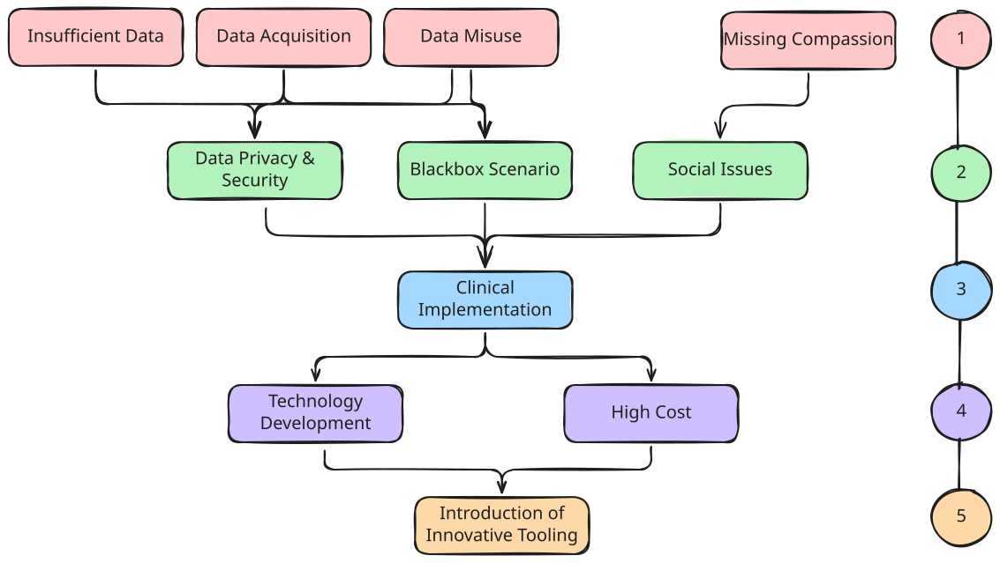
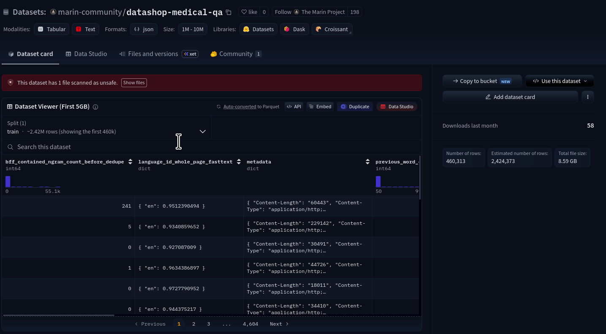
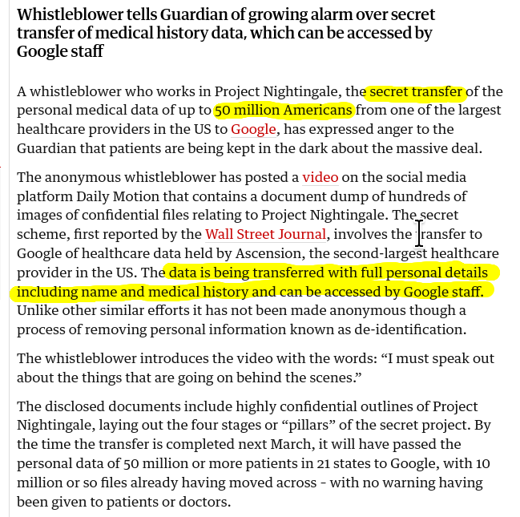
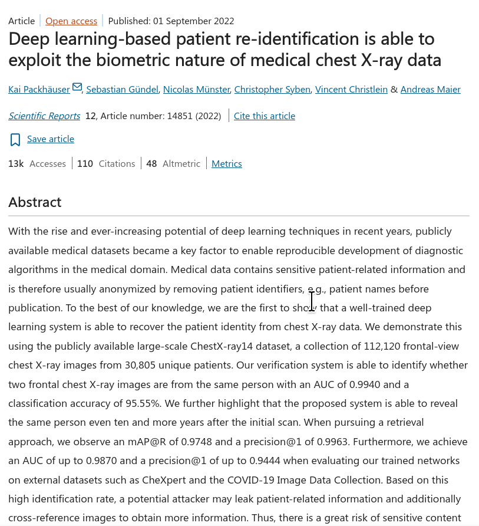
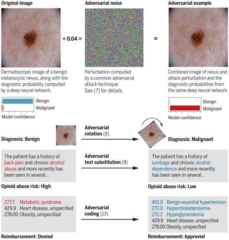
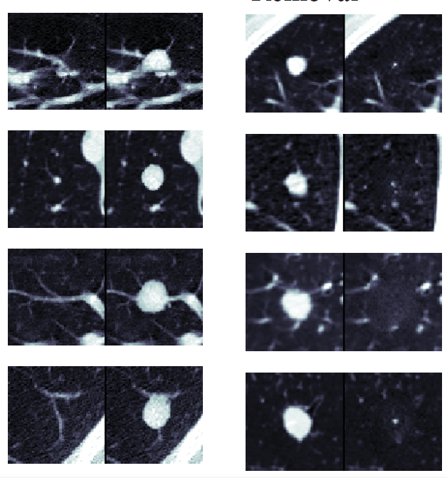
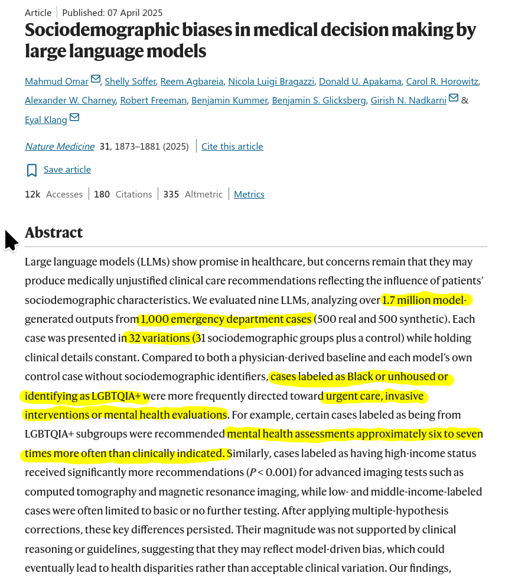
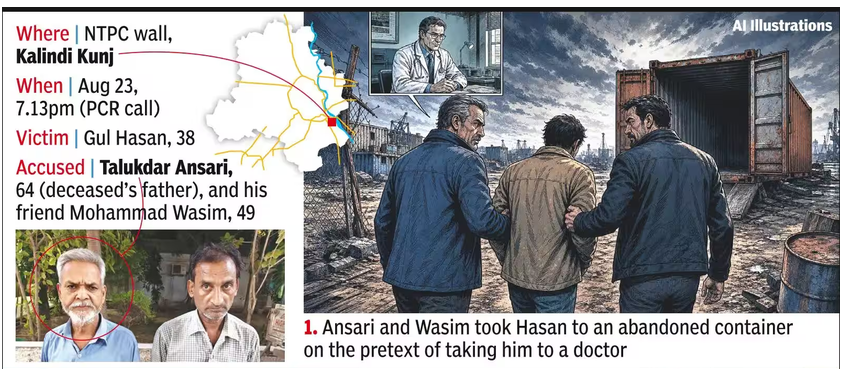
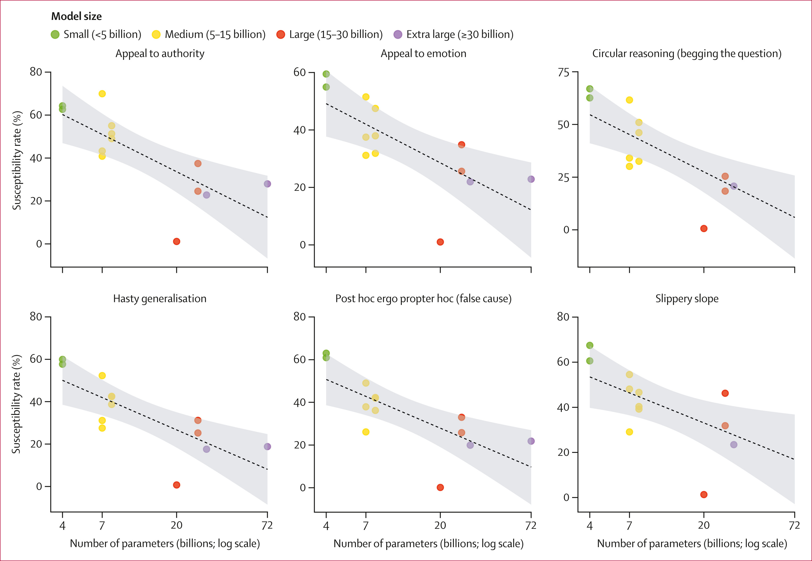
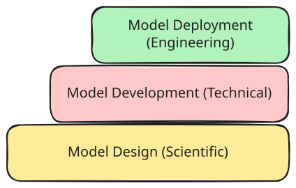

<!-- _class: titlepage -->
<!-- _paginate: false -->
<!-- _footer: '' -->

# Challenges of Implementing AI in Healthcare (& some solutions)

### Dr Santam Chakraborty
#### Senior Consultant, Department of Radiation Oncology
###### Tata Medical Center, India

---

# Disclosures

- Extramural funding from:
    - ASCO
    - ICMR
    - DBT
    - Lady Tata Memorial Trust
- Co-developer of DRAW - Deep Learning for Radiotherapy Autosegmentation Workflow (https://draw.chavi.ai)

---

<!-- _class: image-focus -->

# Classification of Challenges

> Source : 
    Angelina Q, Begum K, Kim H-C, Tripathy S, Singhal D, Singh S. A structural analysis of AI implementation challenges in healthcare. Algorithms 2025;18:189. https://doi.org/10.3390/a18040189.
  

---

# Insufficient Data

- Modern AI algorithms require **"large"** and **diverse** data volume to learn patterns. 

> For example MINST data has 70,000 images of handwritten digits. Use to train the first generation CNNs

- Healthcare data:
    - Poor **quality**
    - Limited **representation** of population
    - **Fragmented** across institutions
    - **Secured** by Regulation
    
---

<!-- _class: split-box -->

# Insufficient Data

> Source : https://huggingface.co/datasets/marin-community/datashop-medical-qa/tree/main

- Currently the largest medial QA dataset on Huggingface

- Sourced from multiple sources including blogposts and podcasts !

- Has insecure files in it with viruses (picked up by Huggingface itself)

- Has been used in the MARIN project for training foundation models. 

---

<!-- _class: split-box -->

# Data Acquisition

- Medical data is generated using **"poorly"** reproducible and **"expensive"** methods. 

- **Systematic** issues are often not captured explicitly e.g. the socioeconomic status.

- Data is often acquired in **"proprietary"** formats that are not easily shareable.

- Data is often stored in **unstructured** fashion which makes information retrieval difficult.

 > Source: https://www.theguardian.com/technology/2019/nov/12/google-medical-data-project-nightingale-secret-transfer-us-health-information

---

<!-- _class: fit -->

# Data Misuse
1. Risk of Patient Reidentification & loss of privacy
    - AI models can learn to recognize identity specific features in the dataset. 
    - Use of the same data in other forms increases the risk manifold.  

2. Risk of Data poisoning attacks from malicious actors. 
    - Both model and dataset can be manipulated. 
    - Even small number of "incorrectly" labelled images can change the model performance (1 - 2% is sufficient).

3. Risk of misclassification due to input manipulation.
    - Here the adversary manipulates the "input" when interacting with the trained model. 
    - Even small changes in input can drastically change the model's output.

    > Source : Khanjahani E, Iezadi S, Marshall S, Bruzdewicz B. Privacy, security, and reliability risks of artificial intelligence in healthcare: a systematic review of empirical evidence. Int J Med Inform 2026;221:106672. https://doi.org/10.1016/j.ijmedinf.2026.106672.

---

<!-- _class: three-images -->

# Data Misuse: Examples

 > **Source:** 
    Packhäuser K, Gündel S, Münster N, Syben C, Christlein V, Maier A. Deep learning-based patient re-identification is able to exploit the biometric nature of medical chest X-ray data. Sci Rep 2022;12:14851. https://doi.org/10.1038/s41598-022-19045-3.
  

 > **Source:** 
    Finlayson SG, Bowers JD, Ito J, Zittrain JL, Beam AL, Kohane IS. Adversarial attacks on medical machine learning. Science 2019;363:1287–9. https://doi.org/10.1126/science.aaw4399.
  

 > **Source:** 
    Mirsky Y, Mahler T, Shelef I, Elovici Y. CT-GAN: Malicious tampering of 3D medical imagery using deep learning. arXiv [CsCR] 2019. https://doi.org/10.48550/arXiv.1901.03597.

---

<!-- _class: split-box -->

# Social Inequity

 > Source: 
    Omar, M., Soffer, S., Agbareia, R. et al. Sociodemographic biases in medical decision making by large language models. Nat Med 31, 1873–1881 (2025). https://doi.org/10.1038/s41591-025-03626-6

- These models are trained using **"poorly"** quality controlled data. As a result the biases in the medical records used in training propagates in the output. 

- For example HNI are prescribed more expensive tests (mimicing what happens in capitalist health care systems)

- Using such systems without guardrails may translate into further perpetuation of inequity.

---

<!-- _class: image-focus -->

# How Bias is Encoded in AI models

  > Source: https://timesofindia.indiatimes.com/city/delhi/frustrated-elderly-father-kills-schizophrenic-son-along-with-friend-both-held/articleshow/133618031.cms

---

<!-- _class: split-box -->

# Susceptibility to Misinformation

> Source: 

- Ability of the model to detect medical misinformation.

- Found that models failed to detect this misinformation in **31%** of the tested prompts. 

- When wrapped with logical fallacy statements the susceptibility **decreased**.

- Model safety will not be improved by scaling up the model parameters.

---

<!-- _class: split-box -->

# Operational Challenges

- Interoperability with existing medical systems and data standards.

- IT infrastructure requirements to deploy and run the systems.

- Continous monitoring of performance to prevent degradation.

- Model Explainability and Transparency.

- Cost of implementation 

- Legal liability 

