<!-- _class: titlepage -->
<!-- _paginate: false -->

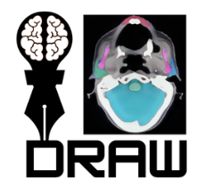

# Data Types and How AI Learns

### Dr Santam Chakraborty
#### Senior Consultant, Department of Radiation Oncology
###### Tata Medical Center, India

---

<!-- footer: '' -->

# Disclosures

- Extramural funding from:
    - ASCO
    - ICMR
    - DBT
    - Lady Tata Memorial Trust
- Co-developer of DRAW - Deep Learning for Radiotherapy Autosegmentation Workflow (https://draw.chavi.ai)

---

<!-- footer: 'Data Types and How AI Learns (2026) · CC BY-NC 4.0' -->

<!-- _class: transition -->
<!-- _paginate: false -->

<!-- _class: cool-list -->

# Outline

1. *What is Data?*
2. *Types of Data*
3. *Special Issues with healthcare data*
4. *Getting data ready for AI*
5. *How AI Learns from this data*

 > ⚠️ Disclaimer: This is a very superficial overview of a vast discipline. (Over-)Simplification is necessary. 

---

<!-- _class: transition -->

# What is Data?

Data are information that is collected and analyzed to make decisions or draw conclusions.

Any thing can be data but in medical context typically information is sourced from medical notes, images, laboratory test results, procedure details etc. - **Healthcare Data**

---

<!-- _class: image-focus -->

# Types of Data

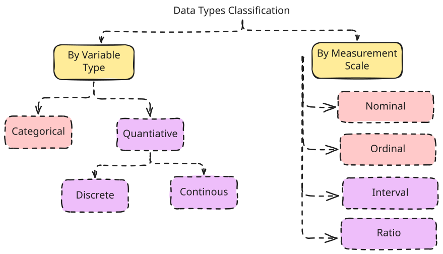

---
# Why Measurement scale matters

| Scale | Data Order | Ranking | Differences | True Zero | Mathematics |
|----|----|----|----|---|---|
|Nominal|No|No|Meaningless|Absent| Non-mathematical | 
|Ordinal|Yes|No|Meaningless| Absent | Non-mathematical |
|Interval|Yes|Yes|Meaningful| Absent | Except Division |
|Ratio|Yes| Yes |Meaningful| Present | All Operations|

> Note a true zero means that zero denotes absence.

---

# How we handle this in AI Training ?

| Scale Type | Mean | Sorting | Handling Procedure | 
|---|---|---| -- |
| Nominal | X | Useless | One-hot encoding |
| Ordinal | X | As per order | Label or Target Mean Encoding |
| Interval | Yes | Min-Max | Multiple Methods |
| Ratio | Yes | Min-Max | Multiple Methods |

> Important: Without proper encoding, many ML models will not work correctly.
---
<!-- _class: image-focus -->
# Sources of Healthcare Data

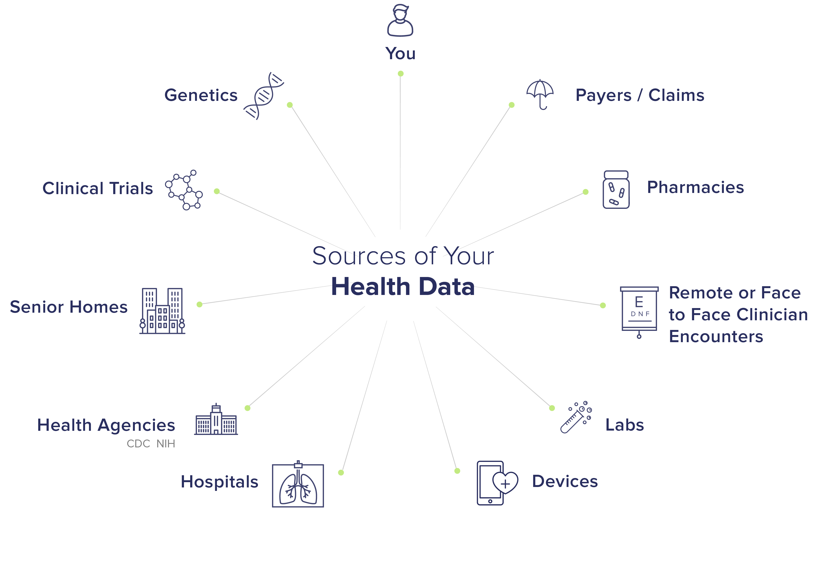

> Source: By Brysonwong01 - Own work, CC BY-SA 4.0, https://commons.wikimedia.org/w/index.php?curid=89546994.

---

# What is special about Healthcare Data?

1. **Sensitivity**: Medical data contains sensitive personal and health information that requires strict privacy and security measures.
2. **Complexity**: Medical data can be complex and unstructured, making it difficult to analyze and interpret.
3. **Regulation**: Medical data is subject to strict regulations and guidelines, such as HIPAA and GDPR, which govern how it can be collected, stored, and used.
4. **Interpretation**: Medical data requires specialized knowledge and expertise to interpret and analyze effectively.
5. **Ethics**: Medical data raises ethical considerations, such as patient consent and data sharing, that must be carefully considered.

---
# What are the Practical Implications?

1. Data can be **Big** and **Small** at the same time- For example Imaging Data
2. Data will be **Longitudinal** - Collected over a period of Time
3. Data will be **Incomplete** - Missing values, missing visits, missing tests
4. Data will be stored in **Proprietary** systems - Not easily accessible
5. Data will be influenced by **Unknown** factors - As we are not fully aware of the complete biological processes involved
6. Data will have **Bias** - Systematic process related to data collection that influences interpretation

---
<!-- _class: image-focus -->

# Biases and their Classification

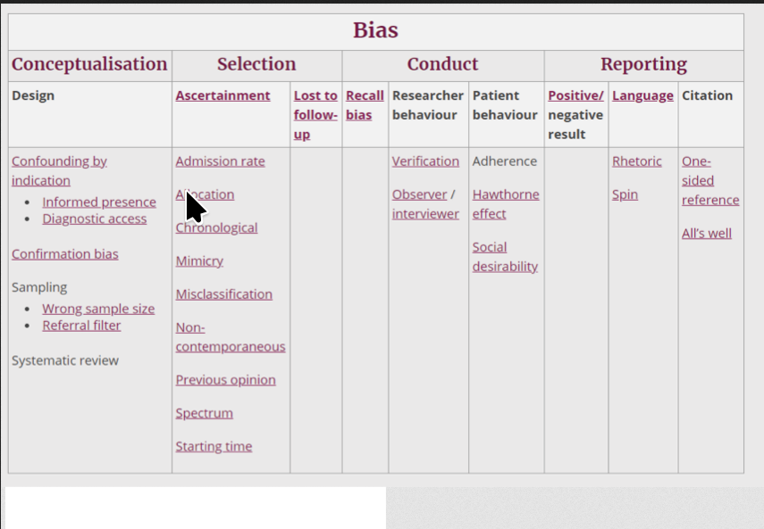

> Source: A taxonomy of biases: progress report https://catalogofbias.org/2020/02/11/a-taxonomy-of-biases-progress-report/.

---
<!-- _class: image-focus -->

# Steps in AI Learning ?

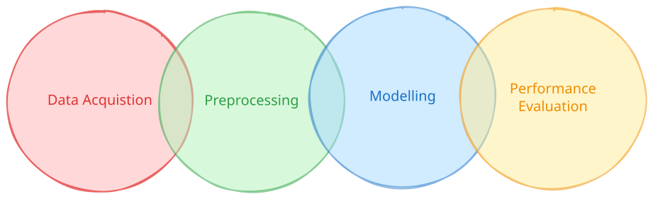

> Note that modelling is probably the EASIEST part of the chain !

---

# Data Preprocessing: Key Terms

1. **Data Cleaning** : Removing incorrect entries (Domain Knowledge needed). Remember no matter the AI GIGO. 

2. **Data Integration**: Merging data from heterogeneous sources into a single dataset. 

3. **Data Transformation**: Converting data into representations which are suitable for ML models.

4. **Data Reduction**: Reducing the number of features that the model has to learn. 

---
<!-- _class: image-focus -->

# Data Cleaning

> AI is not immune to GIGO - If you feed it garbage data (specially AI slop) it will degrade. Image Source: Nepotistically Trained Generative-AI Models Collapse Matyas Bohacek, Hany Farid. https://doi.org/10.48550/arXiv.2311.12202

---
<!-- _class: split-box -->
# Data Transformation

- **Feature Scaling**: The **range** of numerical values is scaled to a uniform value such the variables with different ranges do not influence model prediction.
- **Encoding**: Converting categorical variables into numerical representations.
- **Binning**: Grouping continuous values into discrete intervals. 

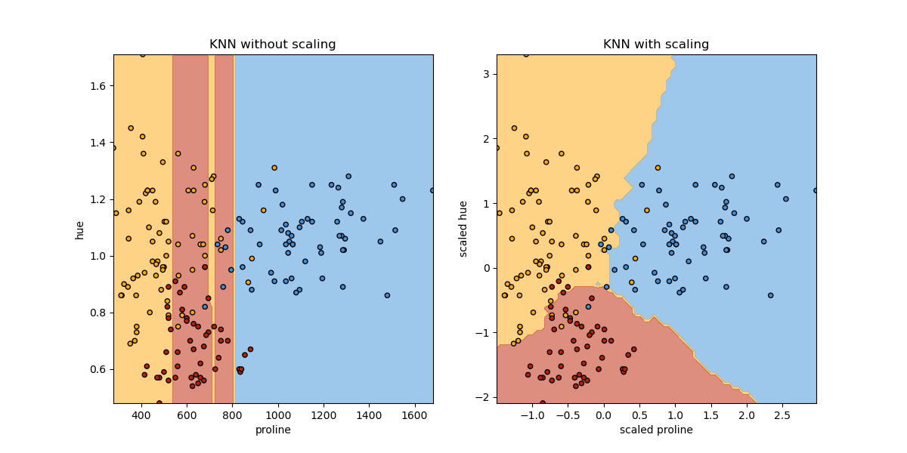

 > In this experiment, proline values were highly variable (larger range) while hue had a small range which resulted in model "learning" differences were due to proline values! Image source : https://scikit-learn.org/stable/auto_examples/preprocessing/plot_scaling_importance.html

---
<!-- _class: split-box -->

# Data Reduction

- **Feature Selection**: Selecting a subset of relevant features for model training.
- **Dimensionality Reduction**: Reducing the number of random variables under consideration.

Feature selection is widely practiced to improve model ***"performance"***. However fundamentally biased as it is dependent on the "Outcome" variable. Dimensionality reduction is better but more complex to interpret & explain

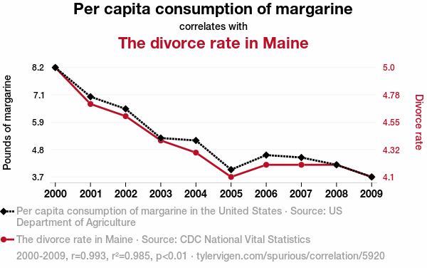

 > Source: https://www.tylervigen.com/spurious/correlation/5920_per-capita-consumption-of-margarine_correlates-with_the-divorce-rate-in-maine     

 > AI says : The lack of artificial spread may have kept the couples from buttering each other up ..

---
<!-- _class: compact-table -->

# Preprocessing tasks by Data Modality

|Modality of Data| Preprocessing Steps | Purpose |
|---|---|---|
|Tabular Data| Missing value imputation, outlier detection, scaling and encoding | Normalize the data matrix for classification & regression |
|NLP| Tokenization, Lowercasing, Stop word removal, Stemming / Lemmatization, Vectorization | Convert text strings into numerical representations and remove linguistic noise|
|Vision| Resizing, Rescaling, Histogram equalization| Makes the input data format uniform, expands dataset to avoid overfitting|
|Time Series| Differencing, Rolling window calculation | Stabilizing Trends and variations, Sequential dependencies |

---

<!-- _class: image-focus -->

# How Models Work !

> Source: https://www.gq.com/story/blue-steel-zoolander-selfie-culture. Fun fact this movie was released in 2001 and was extremely prescient about the selfie culture which would explode in the 2010s.

---

<!-- _class: split-box -->

# How Models Work: For Real !

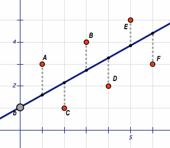

> Source: By Stephen1729 - Own work, CC BY-SA 3.0, https://commons.wikimedia.org/w/index.php?curid=114896374. 

- The most basic example of a "ML" Prediction model is a Linear regression.

- The line tries to find the best **slope** and **"intercept"** which reduces the mean-squared error or difference between predicted and observed values.

- The coefficient is the "slope" while the intercept is the value of Y when X=0. 

- In ML this is called the "bias" term. 😖

---

<!-- _class: split-box -->

# Can we not fit this better ?

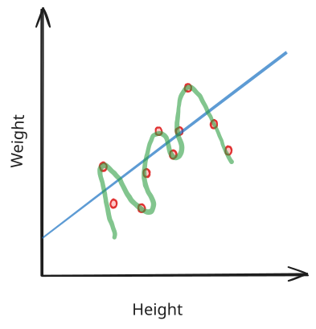

> Idea from Statquest Illustrated Guide to Machine Learning V1.0: Josh Stramer Buy it here : https://shorturl.at/dtGEv. 

- Fitting the data means that we reduce the difference between the predicted and actual values.

- Quiz : Which of these two lines are "fitting" the data better ?

---

<!-- _class: split-box -->

# What happens when we evaluate it ?

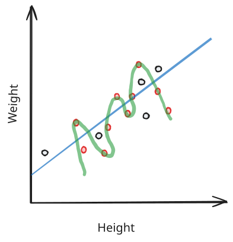

> Idea from Statquest Illustrated Guide to Machine Learning V1.0: Josh Stramer Buy it here : https://shorturl.at/dtGEv. 

- The red dots represent the "training" data. 

- The black dots represent the "testing" data

- A classic illustration of what happens when you have an "overfitted" model. 

---

<!-- _class: split-box -->

# Different types of ML Learning

- **Learning** in the context of AI is very different from what we mean by learning. 

- AI Learning is a mathematical optimization procedure computed using a statistical procedure.

- Unlike **programming** there is no set recipe or algorithm to follow.

- Each type is meant for specific types of tasks.

- **Supervised Learning** : A model is provided with **labelled** data for predicting an outcome.
- **Unsupervised Learning** : Model is provided with **unlabelled** data to find patterns or structure in the data.
- **Reinforcement Learning** : A technique where we provide the model with a **reward** signal and the model optimizes the way to maximize that reward.

---

# How does AI Predict ?

- The broad approaches are:
  - Compute **coefficients** for each variable & figure out how these variables interact with each other (a.k.a Regression)
  - **Partition** the observations based on variable values (a.k.a tree based methods). 
  - Use **similar features** to make predictions (a.k.a nearest neighbour).
  - Compute **non-linear transformation** of variables (a.k.a neural networks).

  > Note that this is not a clear classification. Some methods called "ensemble methods" may use a combination. 

---

<!-- _class: split-box -->

# Neural Network "Architecture"

 - Each **Node** converts an input number to an output number between 0 - 1

 - The **output** value (between 0 - 1) of a node becomes the input value for the weights in the next layer.

 - The activation function can be of different types. Most common type is called a **ReLU (Rectified Linear Unit)**.

 - A ReLU is nothing special: If the input is positive the output is the value else 0. 

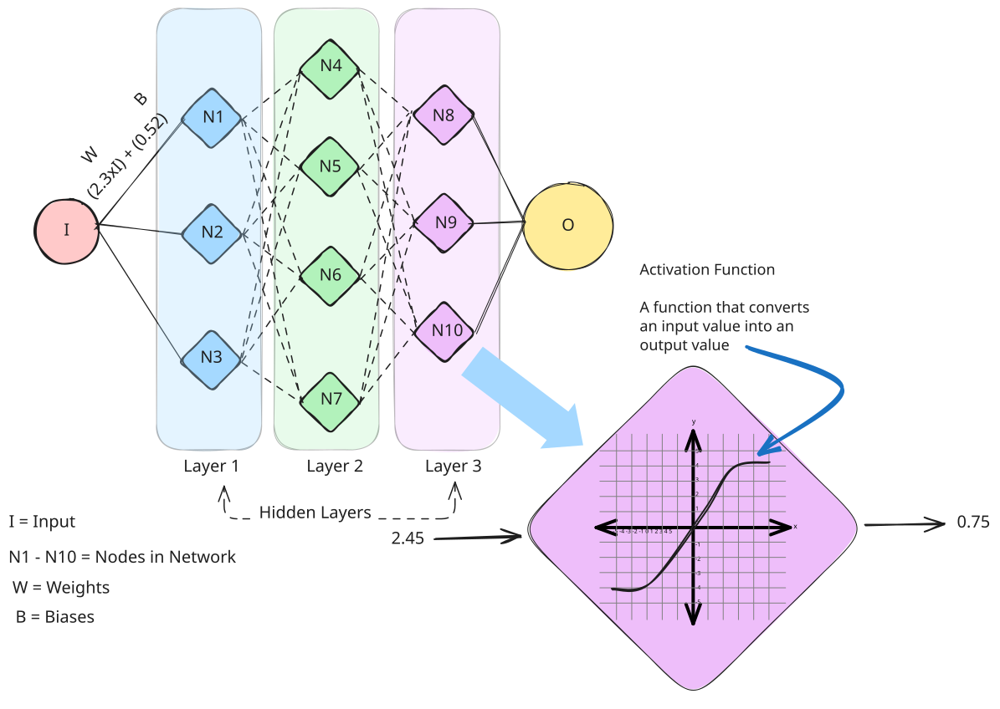

> The first layer of the neural network essentially takes the arbitrary number and converts it into 0 - 1 (analogous to probabilities). Note that this is a special architecture type called "Feed Forward". 

---

<!-- _class: split-box -->

# Neural Network : What happens Inside ?

- The NN has 10 nodes - **3** in 1st layer, **4** in second layer and **3** in third layer
- Each connection between node has a **Weight** and **Bias**.
- There are total **27** such connections (3 in layer 1, 12 in layer 2, and 12 in layer 3) 
- This NN has **27 weights** and **10 biases**. Note that each node has a single bias term.
- Each of these parameters can be tuned to change the model output value. 

> The first layer of the neural network essentially takes the arbitrary number and converts it into 0 - 1 (analogous to probabilities). Note that this is a special architecture type called "Feed Forward". 

---

# What happens during Training ?

- The model starts off with a **Random** set of values for the weights and biases. 
- The model then computes the output from the **training data** for each of the observations. 
- After this is computed, the model calculates the **error** between the predicted output and the actual output. 
- The model then adjusts the weights and biases to **minimize** the error. 
- This process is repeated for a number of iterations (or **epochs**) until the error is minimized. 

---

<!-- _class: split-box -->

# What about Generative AI ? 

- **Generative** AI refers to a class of Neural networks that used to **generate** text, images, audio and other forms of media. 

- These networks are typically trained on large datasets which allows them to exhibit behaviours like **memory** and **recall**.

- These models do not **create** anything. They predict and predict with a great degree of accuracy !

>  Note the difference in the input and output of a generative and discriminative neural network. Source : By Lwneal - Own work, CC0, https://commons.wikimedia.org/w/index.php?curid=153580528

---

# Key Breakthrough: Attention

- How to extract information about the sequence of words in natural language. 

  - "The Cat Ate the Rat" and "The Rat Ate the Cat" - same words with opposite meanings.

- Key step involved -> convert text into a numerical representation called **embedding** where similar words have similar **embeddings**. 

- After this we do **"positional encoding"** - where numerical representations are generated for the location of the word w.r.t others. 

- The key breakthrough in **"Attention"** was to assign each embedding with a query (Q), key (K) and value (V)

---

<!-- _class: split-box -->

# Query, Key and Value : What do they mean ?

 - Query refers to the "word" we want to lookup

 - Key refers to the other words to which this query is related. 

 - Value refers to the "strength" or "importance" of this relationship

 - Attention allowed us to process multiple keys together instead of sequentially allowing massive datasets to be used for training.

 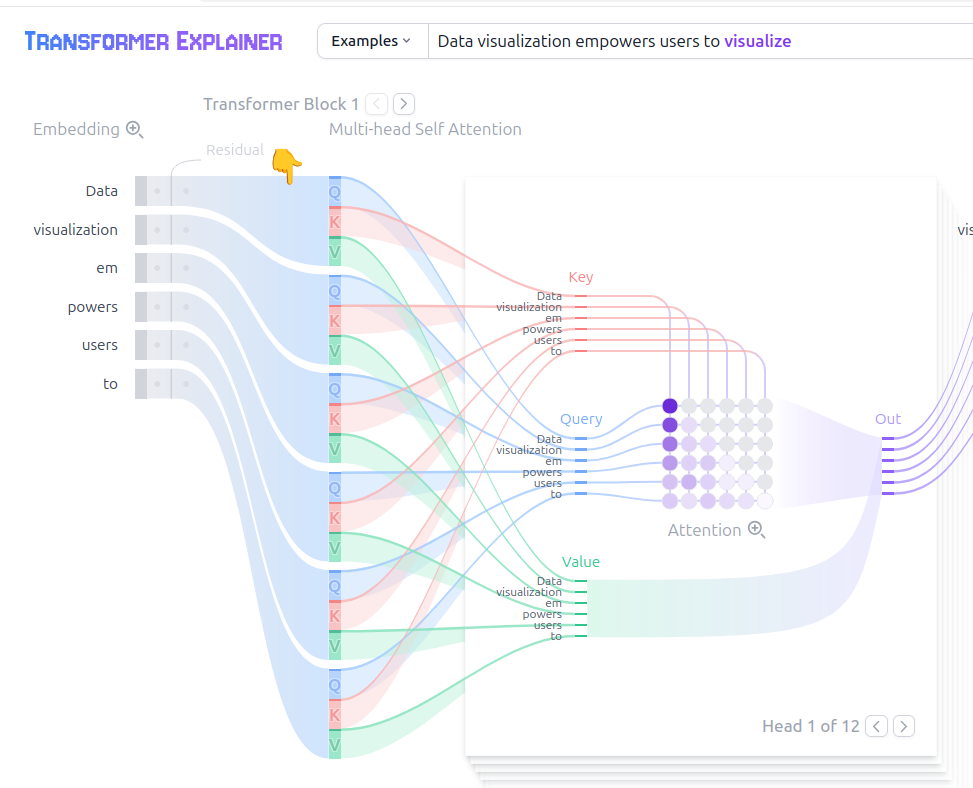

 > Source: https://poloclub.github.io/transformer-explainer/. Fun fact the original paper has been cited by > 250,000 articles. See Vaswani et al (Proceedings of the International Conference on Neural Information Processing Systems, 2017) for more details.

---

<!-- _class: split-box -->

 # Beyond Pre-trained Transformers

 - Joint Embedding Predictive Architecture (JEPA) is proposed as a "World Modelling" approach.

- The input is converted to embeddings.

- The predictor module predicts the embedding from this input. 

- We want to make this embedding as close as possible to embedding of the actual output desired. 

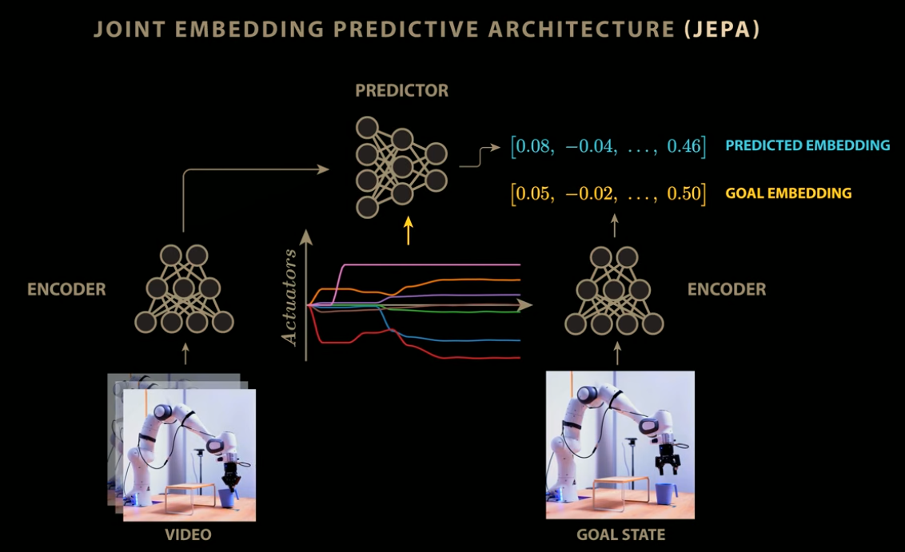

> Source : https://www.youtube.com/watch?v=kYkIdXwW2AE (Video on Youtube) - referencing JEPA models 

---

# Resources needed for AI learning

- GPT v4.0 was trained on 13 trillion **tokens**. 

- This roughly translates to about 10 trillion words. 

- The model is believed to have 1.76 trillion **parameters**

- It took 25,000 NVIDIA A100 GPUs to train the model over 100 days. 

- The overall training cost is estimated to be ~ **$ 100 million**

- Power consumed was **50 GWh**

    > A human body requires about 80 watts per day -> over an entire lifetime of 80 years total power consumed by a human is 0.06792 GWh !

---

<!-- _class: three-images -->

# Summary & Take Home

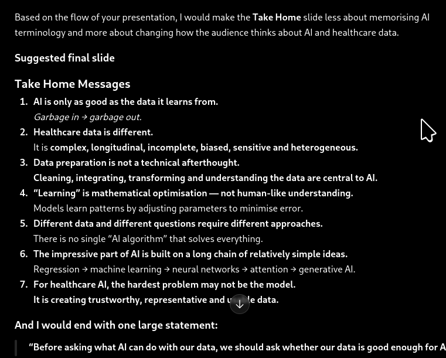

ChatGPT

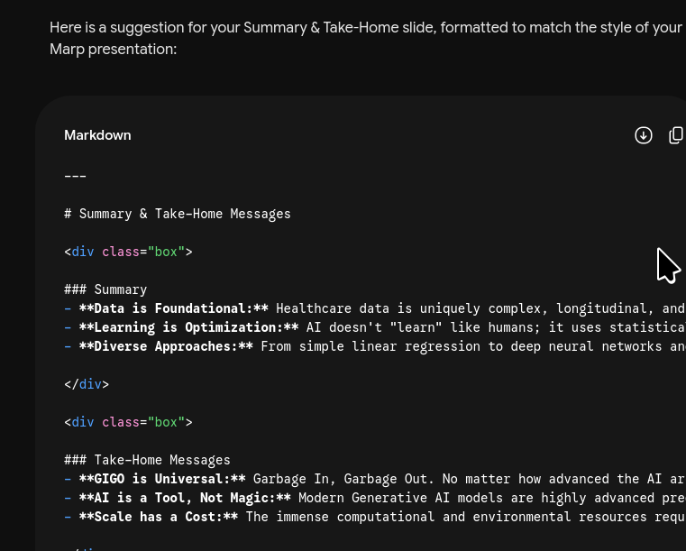

Gemini

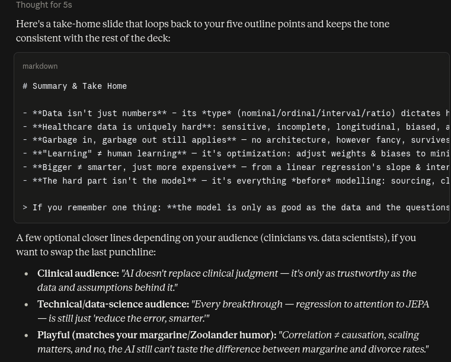

Claude

