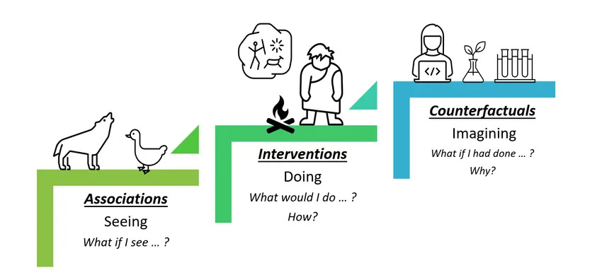
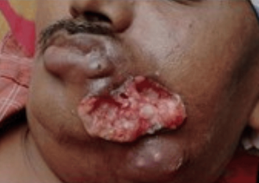
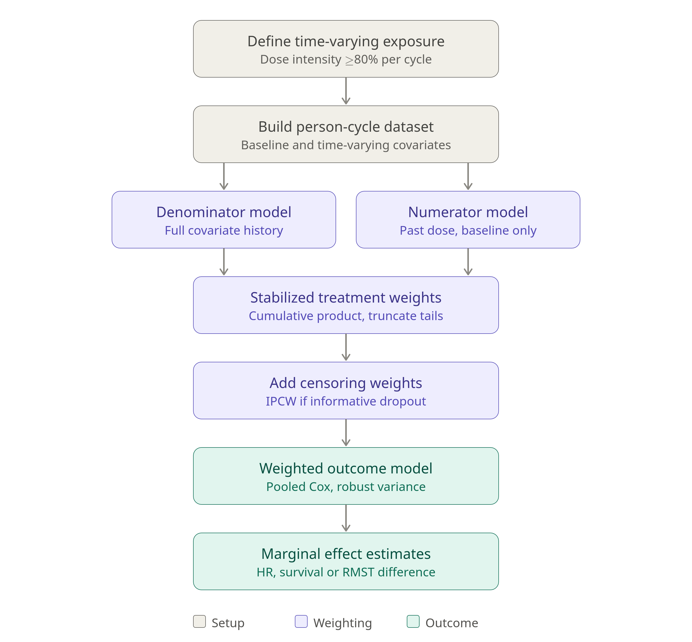

<!-- _class: titlepage -->

<!-- _paginate: false -->

<!-- _footer: '' -->

# Real-World Evidence

#### Target Trial Emulation, Propensity Scores &amp; Immortal Time Bias

### Dr Santam Chakraborty

#### Senior Consultant, Department of Radiation Oncology

###### Tata Medical Center, India

---

# Efficacy vs Effectiveness ?

- **Efficacy** : The extent to which an intervention does more **good** than **harm** under ideal circumstances.
- **Effectiveness** : The extent to which an intervention does more **good** than **harm** under usual circumstances of practice.
- When does Efficacy **not** translate into effectiveneness:
  - *Diagnostic inaccuracy* : Not picking the correct patient for treatment
  - *Provider compliace* : Lack of adherence to guidelines
  - *Patient noncompliance* : Psychological / Social / Economic circumstances
  - *Disparities*: Coverage of health services

---

<!-- _class: split-box -->

# Causal Inference

- We want to choose a better intervention
- **Implication** : Intervention "CAUSES" a Better Outcome
- Inferring causation is clearly possible in RCT 
- Randomization removes the confounding effect pre-randomization variables
- This happens for BOTH known and **unknown** variables. 

    > This is the reason why it is so difficult to infer causation from simple statistical analysis

  > Source: Carey, Alycia & Wu, Xintao. *The Fairness Field Guide: Perspectives from Social and Formal Sciences*. Available under CC BY 4.0 (https://creativecommons.org/licenses/by/4.0/).

---

<!-- _class: split-box -->

# Example RWE study

- Patient with a recurrent, oral cancer presents after failure of two lines of systemic therapy

- Issues with choosing the appropriate therapy:
  - No clear consensus / winner regimens
  - Clinical trials are uncommon 
  - Getting the evidence of the intervention is time-consuming & expensive
  - Difficult to have patients for the trial.

- Lets design a RWE study for this situation which answers the question if Bestoplatin is better than Cisplatin !

  > Source:  Meedimale S, Panda S S, Thummar V, et al. (July 06, 2026) Biosimilar Nivolumab-Based Combination Therapy in Advanced Oral Cavity Squamous Cell Carcinoma: A Real-World Case Series of Five Patients. Cureus 18(7): e112146. doi:10.7759/cureus.112146 

---

<!-- _class: fit -->
<!-- _class: compact-table -->

# Defining the Questions 

| Element | Definition |
| :--- | :--- |
| **Primary Question** | Among R/M HNSCC progressing after 2nd line what is the does Bestoplatin CAUSE better survival as compared to CISPLATIN  |
| **Population** | Adult patients with recurrent/metastatic HNSCC progressing after two lines of chemotherapy. |
| **Intervention** | Initiation of treatment Bestoplatin. |
| **Comparator** | Initiation of an treatment Cisplatin. |
| **Outcomes** | Overall Survival (OS) and Time to Next Treatment (TTNT). |
| **Time Horizon** | 12 months follow-up post-index date. |

 > These elements are also known as "estimands". 
 > You should remember the acronym "PICOT" - also used in systematic reviews. 

---

# Target trial emulation

<!-- _class: split-box -->

-  Target trial emulation is an observational research design that emulates a randomized clinical trial (RCT) structure within a large set of observational data.

- First utilized in 2008 by Hernan et al to reconcile differences between the Women's Health Initiative randomized trial and the observational  Nurses' Health Study

 > Source: Observational studies analyzed like randomized experiments: an application to postmenopausal hormone therapy and coronary heart disease https://doi.org/10.1097/ede.0b013e3181875e61

---

# Protocol components and how we emulate them

<!-- _class: fit -->
<!-- _class: two-way-comparison-table -->

| Protocol element | Ideal target trial | RWE emulation |
| --- | --- | --- |
| Eligibility | Adults with R/M HNSCC, progressed after prior platinum-containing therapy and anti-PD-1 (if available), ECOG 0–2, eligible for 3rd-line chemotherapy | Same criteria applied to EHR/registry data using documented ECOG and treatment history |
| Treatment strategies | Bestaplatin vs Cisplatin | Regimen at first dose of L3 |
| Assignment | Randomization | Propensity score weighting on baseline confounders |
| Time zero | Randomization | Date of first chemo dose (eligibility, assignment and start aligned to avoid immortal time) |

---

# Protocol components and how we emulate them ...

<!-- _class: fit -->
<!-- _class: two-way-comparison-table -->

| Protocol element | Ideal target trial | RWE emulation |
| --- | --- | --- |
| Follow-up | Until death or end of study | Until death, loss to follow-up, or administrative end |
| Outcome | Overall survival | Death confirmed from linked mortality source |
| Causal contrast | ITT effect | ITT-type effect: regimen **started**, regardless of later switching or dose changes |
| Analysis | ITT with adjustment | IPTW-weighted Cox/RMST; IPCW for censoring |

--- 

# What are your data sources ?

- Data Needed: Electronic Health Records (EHR) linked with Claims data.
- Clinical Variables (EHR): ECOG performance status, HPV/p16 status, tumor location, prior lines of therapy.
- Claims Variables: Chemotherapy administration codes, toxicity-related hospitalizations.
- Additional data requirements may relate to laboratory data, utilization rates of various services (from hospital / claims data) and linked registry data. 

  > Ensuring good quality data for RWE for target trial emulation needs an ecosystem not a spreadsheet. 

---

<!-- _class: fit -->

# Example Cohort Definition

- Define the patient, disease, stage, prior treatment, interval to the current treatment precisely. 
- Specify exclusion criteria based on disease side, those with inadequate records. 
- Compare just two therapies : Bestaplatin vs Cisplatin. Data of other third line regimens discarded. 
- Define a **time zero** : Typically C1 date. (implies all which did not get C1 are excluded)
- Followup : Followup till date or progression or followup till 12 months  

---

<!-- _class: fit -->

# Time zero

- Time zero ($t_0$) is the moment someone becomes eligible, is assigned to a strategy, and follow-up starts. 
- All three should happen together.
- Potential problems when this is not done:
  - Followup period defined before treeatment initiation - immortal time bias (e.g. responders vs non-responders)
  - Decide eligibility after treatment has begun - selection bias.
- Baseline covariates (stage, performance status, prior lines of therapy) have to be measured at or before $t_0$. Otherwise they can be effects of the treatment.

---

<!-- _class: fit -->

# Immortal time bias: what it is

- Immortal time is a stretch of follow-up in which the outcome can't happen, because of how we defined exposure. 
- It arises whenever survival timed from enrolment is compared across groups defined by something that happens **later**: objective response, toxicity, a subsequent treatment, or compliance .
- A person gets a treatment only because they survived upto this period. Hence treatment arm has "better" outcomes. 
- Adjusting for covariates doesnot avoid this bias, because it's a problem of how exposure was classified.

---

<!-- _class: fit -->

# Fixing Immortal Time Bias: Landmark analysis

- Pick a landmark time $L$ after cohort entry. Classify exposure by what happened before $L$, start follow-up at $L$, and keep only people alive and event-free at $L$ \[8\].

- It removes immortal time, but it has costs:
  - the result only applies to people who survive to $L$;
  - early events are thrown away, so you lose power;
  - the answer moves with the landmark, so show more than one \[9\].
- It works best when $L$ means something clinically, such as the first response assessment. Pre-specify it.

---

<!-- _class: fit -->

# Fixing Immortal Time Bias: Time-varying Cox models

- Treat exposure as time-dependent. A patient contributes unexposed person-time until they start, and exposed person-time afterwards.
- This removes immortal time and holds up well in simulations.
- Three limits worth remembering:
  - it assumes no unmeasured time-varying confounding, which is a lot to ask when performance status can change from one cycle to the next;
  - it doesn't line up eligibility and baseline covariates with $t_0$, so it isn't a full target trial;
  - if past treatment changes future confounders (performance status, tumour burden, neutrophil count), ordinary Cox adjustment is biased and you need g-methods.

---

# Confounder, Mediator and Collider 

- A **Confounder** is a variable that influence the exposure (treatment with Bestaplatin) as well as outcome (death) and is not in the causal pathway between exposure and outcome. 
- A **Mediator** is like a confounder but is a part of the causal pathway between exposure and outcome. 
- A **Collider** is a variable that is causally related to both the exposure as well as the outcome. Unlike a confounder we do not adjust for colliders in a study.

| Confounder | Mediator | Collider |
|----|----|-----|
| Age, gender, insurance | Treatment related toxicity | Hospital Admission |

---

<!-- _class: fit -->

# Propensity scores: the basics

- The propensity score is the probability of getting the treatment, given baseline covariates:

$$
e(\mathbf{X}) = \Pr(A = 1 \mid \mathbf{X})
$$

- It is a balancing score. Among patients with the same score, the measured covariates look similar in treated and untreated groups.
- The aim is to make the groups comparable on what we measured, much as randomisation would.
- It can be used for matching, stratification, weighting or covariate adjustment.
- Only measured covariates get balanced.

---
<!-- _class: split-box -->

# Example in our study

Identified confounders:
  - Demographics: Age, Sex, Smoking Status. 
  - Disease Characteristics: Tongue vs others.
  - Clinical Status: ECOG score, comorbidity index.
  - Treatment History: Time since initial diagnosis, duration of response to 1st/2nd line therapies.

Important to prespecify the time over which these will be measured. 

We use "inverse probability weighting" - assign weights that are used in subsequent regression modelling. 

Weights are numeric values with higher values given when patient has a higher probablity of receiving Bestaplatin but received Cisplatin and vice versa. 

---

# Alternative method: Overlap weighting

- Each patient is weighted by the probability of getting the other treatment \[17\]:

$$
w_{\text{treated}} = 1 - e(\mathbf{X}), \qquad w_{\text{control}} = e(\mathbf{X})
$$

- The target is the Average Treatment Effect in the Overlap population (ATO), the effect in patients for whom either treatment is a reasonable choice (clinical equipoise). 

---

<!-- _class: fit -->
<!-- _class: compact-table -->

# Comparing the adjustment methods

| Method                | Target estimand                 | With poor overlap                                        | Balance                                                            |
| --------------------- | ------------------------------- | -------------------------------------------------------- | ------------------------------------------------------------------ |
| IPTW                  | ATE (whole eligible population) | Unbounded weights, high variance, possible bias \[18\]   | Balanced in the weighted sample if the PS model is adequate \[14\] |
| Overlap weighting     | ATO (equipoise population)      | Bounded and stable \[17,18\]                             | Exact mean balance for covariates in a logistic PS model \[17\]    |
| PS matching (caliper) | Usually ATT                     | Unmatched patients are discarded \[14\]                  | Balance in the matched sample \[14\]                               |
| IPTW with trimming    | ATE in the retained population  | Fewer extreme weights, but the population changes \[19\] | As IPTW, in the trimmed sample                                     |

---

# Time-varying confounding 

- These are confounders that appear during the study and affect the exposure as well as the outcome. 
- Classical example is a dose limiting toxicity - For example neutropenia in C2 which influences dose delivery in C3. This affects the dose intensity. 
- If the research question is "Does the dose intensity of Bestaplatin affect outcomes ?" then we need to handle this in a specialised method
- Preferred method : Marginal structure model with stabilized inverse probability of treatment / censoring weights across longitudinal time points. 

---

<!-- _class: image-focus -->

# How does Marginal Structural Model works

---

# Detecting Unmeasured confounding

- This is the biggest problem with all RWE. 
- Couple of ways to handle this in a better way is to integrate evaluation of an outcome that should or should not be affected by therapy. 
- Example motor vehicle accidents should not be increased by Bestaplatin. Alternative Bestaplatin being less nephrotoxic should result in reduced nephrotoxicity
- Your model after PS adjustment should reflect this -> if not then there is unmeasured confounding despite matching. 

---

<!-- _class: fit -->
<!-- _class: compact-table -->

# Summary of the final design

| Step | Action in HNSCC Study |
| :--- | :--- |
| **1. Design** | Active Comparator New-User (Bestaplatin vs Cisplatin) |
| **2. Confounding** | IPW for baseline; MSMs for dynamic adherence |
| **3. Execution** | ITT and Per-Protocol estimators |
| **4. Validation** | Positive (Nephrotoxicity) & Negative (Road traffic accidents) Controls |

---

# Take home 

- Your 250 patient , 1000 patient and 10000 patient retrospective case series is not a RWE study. 

- Proper RWE study requires a well thought out carefully designed protocol (see HARPER : https://onlinelibrary.wiley.com/doi/10.1002/pds.5507)

- Causal inference is very hard - probably much easier to design a RCT. 

